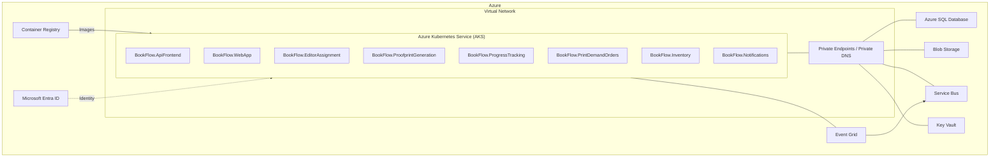

# BookFlow .NET 10 applications

Implementation of the [service specifications](../documentation/Service-Specifications.md).

See the [Azure application and container diagram](../documentation/Readme#azure-application-and-container-architecture) for the eight production containers, Azure resources, networking, identities and external integrations.

## Azure overview

Download the [PowerPoint container overview](../documentation/BookFlow-Azure-Overview.pptx) for a single-slide diagram with official Azure product icons and editable container labels.

Target deployment; each box inside AKS is a separate container. Connections summarize Azure dependencies, not individual application flows.



`BookFlow.LocalProviders` is development-only and is not deployed to Azure. Deployment prerequisites and detailed routing are covered in the linked architecture diagram above.

## Projects

| Application | Responsibility | Durable input |
| --- | --- | --- |
| `BookFlow.WebApp` | Browser client, manuscripts, edits, feedback, approval, orders and authorized downloads | Application API |
| `BookFlow.ApiFrontend` | JWT authentication, throttling, callback validation, private proxy and Event Grid webhook | Callback outbox |
| `BookFlow.EditorAssignment` | Least-loaded active editor selection within a publisher tenant | `editor-assignment` |
| `BookFlow.ProofprintGeneration` | Immutable-version PDF generation and storage | `proofprint-generation` |
| `BookFlow.ProgressTracking` | Ordered lifecycle history and progress projection | `progress-tracking` |
| `BookFlow.PrintDemandOrders` | Initial print runs and publisher reprints | `print-demand-orders` |
| `BookFlow.Inventory` | Stock, production, delivery, distribution, sales and alert ledger | `inventory` |
| `BookFlow.Notifications` | Separate email/availability handlers, durable HTTP acceptance and retryable delivery | SQL notification receipts, **not Service Bus** |
| `BookFlow.LocalProviders` | Development-only authenticated HTTP test doubles and short-lived demo JWTs | Local files |

Each application has its own adjacent `.Tests` project, using xUnit, Moq and **FluentAssertions 7.0.0**. `BookFlow.Core` contains shared contracts/domain types. `BookFlow.Infrastructure` contains EF Core persistence, Azure/local transport, authentication and HTTP adapters. `BookFlow.Testing` provides an isolated SQLite fixture; `BookFlow.Infrastructure.Tests` tests shared reliability behavior.

Each publisher organization is represented by one tenant containing one publisher participant. Authors, editors and distributors are registered within that tenant by an administrator. JWTs carry `oid` (participant identity), `tid` (tenant) and one application role in `roles`. Production uses Entra JWT validation; a different organization-to-Entra-tenant mapping would require an explicit membership mapping rather than trusting client-supplied tenant IDs.

## Build and test

Run from this directory with a .NET 10 SDK:

```powershell
dotnet build .\BookFlow.slnx
dotnet test .\BookFlow.slnx
```

The test runner is VSTest with xUnit v2. Tests cover domain rules, mocked integrations, SQLite constraints/transactions, duplicate handling, ordering, failure persistence and the complete upload/edit/revise/approve/print/inventory workflow. They do not claim to reproduce Azure networking or identity.

## OpenAPI and endpoint reference

See [API-Endpoints.md](API-Endpoints.md) for every HTTP endpoint, roles, request semantics, response codes and documentation access.
All applications generate `/openapi/v1.json` in Development. The frontend's document at <http://localhost:8080/openapi/v1.json> includes the concrete application API routes as well as callback/notification ingress, not the wildcard proxy. The provider document at <http://localhost:8081/openapi/v1.json> requires the provider bearer credential. Private workers document their health probes only. Production documentation remains disabled.

## Local Docker with Rancher Desktop

1. Start Rancher Desktop and select **dockerd (moby)** under **Preferences > Container Engine**. Wait for the engine to become ready. The `containerd` engine uses nerdctl and cannot run these Docker Compose commands.

   The [Rancher-Docker.ps1](Rancher-Docker.ps1) helper locates Rancher's Windows Docker CLI even when it is not on `PATH` and explicitly uses the `default` Docker context (`docker_engine` named pipe). It does not change the global context or target the stale Docker Desktop `desktop-linux` context. Remove `DOCKER_HOST`/`DOCKER_CONTEXT` overrides if the helper reports them.

   ```powershell
   powershell.exe -NoProfile -ExecutionPolicy Bypass -File .\Rancher-Docker.ps1 info
   powershell.exe -NoProfile -ExecutionPolicy Bypass -File .\Rancher-Docker.ps1 compose version
   ```
2. Generate local credentials once. The generated `.env` is ignored by Git and excluded from Docker build contexts:

   ```powershell
   powershell.exe -NoProfile -ExecutionPolicy Bypass -File .\Initialize-Local.ps1
   ```

   The execution-policy option affects only this subprocess; it does not change system policy. On hosts where scripts are permitted, invoke the script directly.

3. Build and start:

   ```powershell
   powershell.exe -NoProfile -ExecutionPolicy Bypass -File .\Rancher-Docker.ps1 compose up --build -d
   ```

4. Exercise the full workflow and register the four demo participants:

   ```powershell
   powershell.exe -NoProfile -ExecutionPolicy Bypass -File .\Smoke-Test.ps1
   ```

5. Open <http://localhost:8080>. Use a demo token obtained from the provider endpoint; the provider bearer token is the value in `.env`:

   ```powershell
   $providerToken = (Get-Content .\.env | Where-Object { $_ -like 'BOOKFLOW_PROVIDER_TOKEN=*' }).Substring('BOOKFLOW_PROVIDER_TOKEN='.Length)
   $author = Invoke-RestMethod http://localhost:8081/tokens/Author -Headers @{ Authorization = "Bearer $providerToken" }
   # Paste $author.token into the browser client's access-token field.
   ```

   `/tokens/Editor`, `/tokens/Publisher`, `/tokens/Distributor`, `/tokens/Admin`, `/tokens/PrintProvider`, and `/tokens/EventGrid` issue the corresponding development identities. Tokens expire after one hour. These endpoints are development-only and protected by the provider token.

6. Stop containers without removing persisted workflow data:

   ```powershell
   powershell.exe -NoProfile -ExecutionPolicy Bypass -File .\Rancher-Docker.ps1 compose down
   ```

Only the API frontend and development provider expose host ports, both bound to loopback. Other services communicate on the Compose network. Images use .NET 10 multi-stage builds and run as the non-root `app` user. The `bookflow-data` named volume stores SQLite, immutable blobs and provider idempotency records. A one-shot initializer creates the schema before the applications start.

The stack has been verified on Rancher Desktop's Linux dockerd engine: all images build, all nine applications run as non-root, the smoke workflow and Event Grid validation succeed, OpenAPI loads, and approved manuscript state plus proofprint PDFs survive a WebApp container restart. The verification stack uses a separate Compose project and does not modify Rancher's Kubernetes containers.

The development provider returns a synthetic PDF, **not a real rendering of manuscript content**; it does not print books, send email or notify actual publishers. Provider responses are idempotent across restarts. Production provider contracts must be implemented or mapped by the real providers.

### Local-mode differences

The self-contained Compose environment deliberately uses SQLite and file blobs rather than requiring SQL Server, Azurite or the Service Bus emulator. Its event adapter persists separate work deliveries with the same subscription allowlists as Bicep and sends notifications over HTTP through the frontend. This makes all workflows runnable without Azure credentials, while preserving durable outbox/inbox behavior. SQLite serializes writers and is **not** the production scaling model.

Local mode refuses to start outside `Development`. It does not emulate Event Grid, Service Bus delivery locks/DLQs, Azure private DNS, workload identity or cloud scaling. Azure mode uses SQL Server, Azure Blob Storage, Event Grid and Service Bus instead.

### Native full-process verification

For development machines with the SDK but no running Docker engine:

```powershell
powershell.exe -NoProfile -ExecutionPolicy Bypass -File .\Verify-Local.ps1
```

This builds the solution, creates an isolated temporary database and credentials, starts all nine applications on temporary loopback ports, checks readiness/OpenAPI, runs the workflow, verifies authorized PDF downloads and state after a WebApp restart, then stops only its own processes and removes its temporary data. It does not leave a server running or alter existing Docker volumes.

## Azure configuration

Build each image using this directory as the context, for example:

```powershell
powershell.exe -NoProfile -ExecutionPolicy Bypass -File .\Rancher-Docker.ps1 build -f .\BookFlow.WebApp\Dockerfile -t bookflow-webapp:latest .
```

For each deployed application configure:

| Setting | Value |
| --- | --- |
| `BookFlow__Mode` | `Azure` |
| `ASPNETCORE_ENVIRONMENT` | `Production` |
| `ConnectionStrings__BookFlow` | Azure SQL connection string using Entra authentication and certificate-validated TLS |
| `Authentication__Authority` | Entra authority for the trusted tenant |
| `Authentication__Audience` | BookFlow API application audience |
| `BookFlow__BlobEndpoint` | Storage account Blob service HTTPS endpoint |
| `BookFlow__EventGridEndpoint` | Bicep topic endpoint (outbox publishers) |
| `BookFlow__ServiceBusNamespace` | Fully qualified namespace, e.g. `NAME.servicebus.windows.net` (bus workers) |
| `BookFlow__Topic` | `bookflow-events` |
| `BookFlow__WebAppUrl` | Private WebApp service URL (frontend) |
| `BookFlow__NotificationsUrl` | Private Notifications service URL (frontend) |
| `BookFlow__PublicUrl` | Public application HTTPS URL (notifications) |
| `BookFlow__ListingHosts__0`, etc. | Approved distributor listing hosts |
| `Inventory__LowStockThreshold` | Positive low-stock alert threshold; defaults to `10`, consistent across frontend/inventory |
| `Providers__BaseUrl` | HTTPS gateway implementing the provider-neutral contracts (print/notification applications) |
| `Providers__Token` | Provider credential from Key Vault/approved Kubernetes secret injection; never commit it |

For example, the SQL connection string shape is:

```text
Server=tcp:SERVER.database.windows.net,1433;Database=BookFlow;Authentication=Active Directory Workload Identity;User Id=WORKLOAD_CLIENT_ID;Encrypt=True;TrustServerCertificate=False
```

The Microsoft SQL client Azure authentication extension is included. Runtime SQL configuration rejects passwords, unvalidated certificates and non-Entra authentication. Keep `BookFlow__InitializeDatabase` disabled for normal production workloads; apply the versioned migrations as a controlled release step using a separately authorized migration identity. The generated [SQL script](BookFlow.Infrastructure/Migrations/BookFlow.sql) is idempotent for SQL Server/Azure SQL:

```powershell
dotnet tool restore
dotnet tool run dotnet-ef migrations script --idempotent `
  --project .\BookFlow.Infrastructure\BookFlow.Infrastructure.csproj `
  --output .\BookFlow.Infrastructure\Migrations\BookFlow.sql
```

SQL users/roles must be created separately. Use the Bicep workload identity client ID on the `bookflow` Kubernetes service account in the `bookflow` namespace, and enable the `azure.workload.identity/use: "true"` pod label. Run only the frontend behind secured external ingress; other services remain private. Configure Kubernetes liveness at `/health/live`, readiness at `/health/ready`, resource/replica limits and Service Bus backlog scaling for the five workers.

### Cloud prerequisites that are not deployed by this code

- API registration, Entra app roles, participant provisioning, production provider configuration, ingress/TLS, Kubernetes deployments and observability infrastructure require environment-specific setup.
- Configure the Event Grid webhook's Entra tenant/application audience and grant the Event Grid service principal the `EventGrid` application role. The current Bicep webhook definition only sets its URL; it must be extended/configured for authenticated webhook delivery before using this API. Validation requests also require that role.
- Validate the Bicep deployment before release. Service Bus private endpoints require a supported tier (Premium); the current template uses Standard. Verify that the user-assigned Event Grid delivery identity is attached to its topic. These infrastructure prerequisites are not bypassed by the applications.
- Grant runtime SQL permissions and verify private Blob/SQL/Service Bus connectivity in the actual Azure environment. No Azure deployment is performed by local tests.

## Provider-neutral HTTP contracts

All provider requests use `Authorization: Bearer TOKEN` and `Idempotency-Key`.

| Method/path | Request | Successful response |
| --- | --- | --- |
| `POST /proofprints` | Manuscript bytes, `application/octet-stream` | PDF bytes, `application/pdf` |
| `POST /orders` | `PrintSubmission`: `bookId`, `title`, `isbn`, `distributorId`, `quantity` | JSON `{ "reference": "stable-provider-order-id" }` |
| `POST /emails` | `NotificationMessage`: `destination`, `template`, `link`, `publisherApi: false` | Any 2xx |
| `POST /publisher-notifications` | Same shape; `destination` is publisher identity, `publisherApi: true` | Any 2xx |

Requests have 30-second timeouts and at most three attempts per dispatch for transport errors, 408, 429 and 5xx responses. Other client errors are permanent. Persisted jobs retry up to 10 dispatches with backoff before dead lettering. The provider **must** honor stable idempotency keys: `proofprint:VERSION_ID`, `print-order:ORDER_ID`, and `EVENT_ID:TEMPLATE` for notifications.

PrintOnDemand/distributor callbacks post an Event Grid-shaped `DomainEvent` to `/callbacks`, authenticated as `PrintProvider` or the specific `Distributor`. Quantities are nonnegative integers. `BooksPrinted` and `BooksDelivered` must reference a valid print order for the book/distributor. `StockUpdated` is an absolute snapshot; `BooksDelivered` is a stock credit, `BooksSold` and `BooksDistributed` are debits, and `BooksPrinted` affects production totals only. Providers must agree on a monotonically increasing sequence for each book/distributor stream; do not reset it per callback or provider.

Late deltas are reconciled by replaying the ordered ledger without regressing the high-water mark. Conflicting sequences and stale absolute reports require reconciliation. A debit before its missing credit is retried and never produces negative stock. `LowStockAlert` (10 by default, configurable) and `StockDepleted` (0) record alerts without subtracting stock again. Listing callbacks require an allowlisted HTTPS host.

## Reliability and operations

Domain mutations and outgoing events commit together in SQL. Upload reservations are persisted before writing immutable blobs; failed uploads leave a visible `Pending` reservation and no domain event. Retry the original command/key to recover. Operators can inspect reservations and remove truly abandoned files only after confirming that no version refers to them.

Event handlers commit their inbox receipt, state changes and resulting events together. Outbox publishers use short database leases and perform network calls outside the claim transaction. A crash after a remote success can redeliver; inbox records and stable provider keys prevent duplicate effects. Keep idempotency/inbox records beyond the transport retention windows.

Notifications are acknowledged only after SQL receipt storage, before recipient resolution or provider delivery. This avoids losing a proofprint notification when editor assignment is still in flight. Recipient resolution and provider delivery have independent durable retries.

Inspect `Outbox`, `LocalDeliveries`, `NotificationDeliveries`, `Uploads`, `Inbox`, `History`, and `Ledger` tables using an authorized database tool. Alert on `DeadLettered`, sustained `Attempts`, failure codes and stale leases. Runtime logs include event IDs/consumer names/failure codes rather than manuscript contents or credentials. Native/Azure workers have safe cancellation and message settlement behavior.

To replay a repaired local/SQL job, preserve its event ID/payload and reset `DeadLettered`, `Attempts`, `FailureCode`, and `NextAttemptAt`; reset `LeaseUntilUtcTicks`/`LeaseId` for an expired outbox claim. Never delete successful inbox receipts to force duplicate side effects. For Azure Service Bus, inspect the subscription DLQ using an authorized Service Bus tool and replay repaired messages with their original ID and `eventType` property. Event Grid dead letters remain in the Bicep dead-letter blob container for operator-controlled replay.
